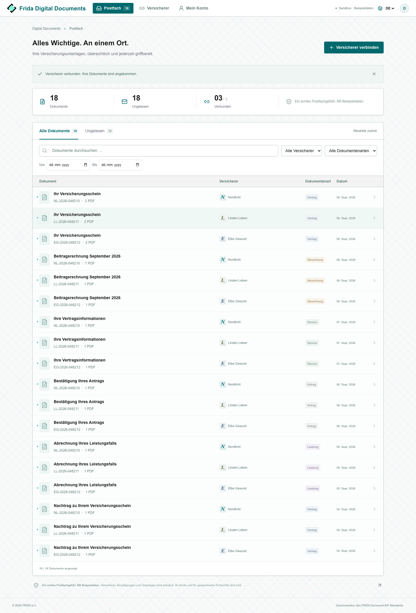

# FRIDA Digital Documents

A bilingual customer sandbox for the FRIDA Document API. Real Supabase accounts and saved progress; fictional insurers, simulated consent, and sample insurance documents. The interface follows the adjacent Cyber Demo's teal/white FRIDA design tokens and brand assets.



## Run locally

Requires Node.js 22.13+ and Docker. Run commands from this folder.

```sh
npm ci
npx supabase start -x vector,logflare,studio,imgproxy,edge-runtime,supavisor
node scripts/configure-local.mjs
npm run dev -- --port 3007
```

If `.env.local` already exists, keep the existing local configuration and skip `configure-local.mjs`. The app does not use a service-role key. The local Supabase instance is independent of Cyber Demo and uses ports 55420–55429.

- Application: [localhost:3007](http://localhost:3007)
- Local confirmation/recovery emails: [Mailpit](http://localhost:55424)
- Local Supabase API: `http://127.0.0.1:55421`

Create an account at `/register`, then open its confirmation email in Mailpit. Emails stay on this machine in local development. There are no built-in passwords or fake login bypasses. Each new account starts empty. Connect a demo insurer to populate the inbox. The fictional policyholder inside all documents is Alex Morgan, regardless of the account email.

Stop the local services with `npx supabase stop`. This preserves local database data by default. The application server can be stopped with Ctrl+C.

## Customer flows

The inbox supports full-text title/policy/insurer search, unread state, insurer/category/date filters and newest-first ordering. Choose among Nordlicht, Linden Leben and Elbe Gesund. Connection uses a three-step simulated authorization/consent journey and retrieves six documents per insurer. Three policies include a second PDF attachment (18 documents, 21 files total). Previews and downloads contain visibly marked sample content in the selected language.

Connections can be refreshed or disconnected. Imports are idempotent; disconnection prevents further retrieval while retaining previously imported documents and downloads. Reset removes only the current account's connections, consent events and imports. The real account remains.

## Dedicated hosted setup / Vercel

1. Create a **new, dedicated Supabase project**. Apply `supabase/migrations/20260910000000_sandbox.sql` using its SQL editor or link this directory and run `npx supabase db push`. Do not use the Cyber Demo database or its migrations.
2. Configure email/password Auth with email confirmation enabled, a minimum password length of 12, and a working SMTP provider. Configure the site URL and allow exactly `https://YOUR_DOMAIN/auth/callback` and `https://YOUR_DOMAIN/auth/callback?next=/reset-password`. The standard Supabase confirmation/recovery email templates work with this PKCE callback. Initiate and finish the email flow in the same browser.
3. Set `NEXT_PUBLIC_SUPABASE_URL`, `NEXT_PUBLIC_SUPABASE_ANON_KEY` (the public anon or publishable key), and `NEXT_PUBLIC_SITE_URL` to the exact application origin. Never copy local development keys into a hosted project. Never put a service-role key in the client.
4. Import this folder into Vercel as a Next.js project (`npm run build`). There are no cron jobs or persistent local files. PDF files are rendered on demand.
5. Before inviting external users, supply the actual operator's privacy/legal details and configure your email sender. The current privacy note describes the sandbox's data use, not a complete production legal notice.
6. Smoke-test signup, confirmation and recovery against the hosted domain, and verify two separately registered accounts cannot access one another's data. No hosted infrastructure has been provisioned by this implementation.

With missing Supabase configuration, authentication screens show an honest setup state and API requests return 503. The app never falls back to pretending that an account exists.

## API and implementation

`contracts/DocumentApi.yaml` is a copy of the adjacent specification, with only the malformed `/insurance-infos` 401 response indentation corrected. Source files in the adjacent repository are untouched. Use the application origin plus `/api` as the base URL:

| Method | Path | Behavior |
| --- | --- | --- |
| GET | `/api/documents?sortAsc=true` | Documents for active simulated connections; optional ISO `fromTimestamp` and `toTimestamp` |
| GET | `/api/insurance-infos` | Insurer metadata for active connections |
| GET | `/api/files/{uuid}` | Sample PDF as binary attachment; imported files remain accessible after disconnect |
| GET | `/api/workspace` | Current account's saved inbox and connections |
| POST | `/api/connections` | `action: connect/sync/disconnect`, `insurerId`; connect also requires `accepted: true`, `locale: de/en` |
| PATCH | `/api/documents/{uuid}` | Mark an imported document read |
| POST | `/api/reset` | Reset current account's sandbox progress |

Reads support a verified Supabase Bearer JWT or the first-party cookie session. UI mutations additionally require an Origin matching `NEXT_PUBLIC_SITE_URL`. There are no upload endpoints. File requests accept `locale=de/en`; `preview=1` returns inline `application/pdf`, otherwise the documented `application/octet-stream` download.

The provider adapter in `src/server/provider.ts` owns search, insurer metadata, file lookup and file generation. A real integration would supply an implementation and its insurer-specific OAuth configuration; no real insurer connectivity is claimed. API field names and enums remain faithful to the supplied specification, including `casuality`. Additional bilingual/sample fields are private UI metadata and are stripped from the Document API response.

Pagination uses inclusive time bounds and a nominal limit of five. The simulator returns the complete timestamp group at the page boundary, even if this exceeds the nominal limit. The collector advances one millisecond after that group and deduplicates by UUID. A future provider must honor that boundary guarantee or supply its own pagination adapter; the source API has no secondary cursor. Stalled pagination fails explicitly.

## Account isolation

All account-owned tables use row-level security. Browsers can select their own rows and update only their own `read_at` column. Consent, import, disconnect and reset are narrowly scoped SQL functions that derive ownership from `auth.uid()`, validate inputs, and serialize per user with a transaction lock. Imported metadata comes from the server-owned catalog, never from caller-provided JSON. Consent records preserve text, version, language and timestamp. No application service-role credential is needed.

Downloads require either an active connection or a document imported by the requesting account. Protected responses use `private, no-store`. Cross-origin mutations are rejected. Auth callback destinations are restricted to the inbox or password reset page.

A single 1.1-second retry handles PostgREST's specific `PGRST303 / JWT issued at future` pre-execution rejection ([upstream issue](https://github.com/PostgREST/postgrest/issues/5196)). Other failures are not automatically replayed, and token validation is never relaxed.

## Verification

```sh
npm run lint
npm run typecheck
npm test
npm run build
# With local Supabase and the app running on port 3007:
npm run test:integration
npx playwright install chromium
npm run test:e2e
```

Unit tests cover API vocabulary, pagination boundaries, input validation, PDF generation and bounded retries. Integration tests use two real local Supabase users and exercise HTTP authentication, consent, RLS, file ownership, disconnection and reset. Browser tests run real registration, confirmation and recovery through Mailpit, plus the customer workflow, PDFs and mobile/bilingual layouts. Test users are removed after each suite; ordinary accounts are untouched. Local integration helpers refuse non-local Supabase URLs.

Browser screenshots are written to `test-results/verified`. E2E requires a running local Docker instance; the suite starts the Next.js development server if needed. Hosted email delivery and hosting configuration require a separate smoke test after deployment.
